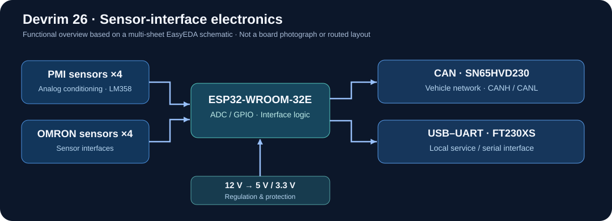

# Devrim 26 — Sensor Interface PCB

**METU Formula Racing | Electronics Team | 2026**

This project documents the sensor-interface board developed for our **Devrim 26** race car. I worked on the PCB as part of the METU Formula Racing electronics team. The board was fabricated in China, tested after delivery, and used on the car.



## Hardware

The design brings several sensor interfaces and vehicle communications onto a single ESP32-based board.

| Block | Main components |
| --- | --- |
| Microcontroller | ESP32-WROOM-32E |
| Vehicle communication | SN65HVD230 CAN transceiver |
| USB communication | FT230XS USB–UART bridge |
| Analog front end | LM358-based conditioning circuits |
| Sensor inputs | Four PMI and four OMRON channels |
| Power | 12 V input, 5 V and 3.3 V regulation and protection |

The block diagram above is drawn from the schematic. It is not a PCB layout or a photograph of the assembled board.

## Development and testing

The board went through schematic design, fabrication, assembly-level testing, and vehicle integration. It was used on Devrim 26 and passed the technical checks applicable to the team's Formula Racing entry.

This repository preserves the **EasyEDA schematic export**. The original PCB layout, Gerbers, board photographs, and test measurements are not included here, so those stages are described rather than reproduced.

## Files

- [EasyEDA schematic](source/SCH_sensorpcb_2026-11-09.json) — seven-sheet design.
- [Circuit breakdown](docs/design-summary.md) — components, interfaces, and design organization.
- [Architecture diagram](assets/formula-sensor-architecture.svg) — overview of the sensor and communication blocks.
- [Schematic structure check](tools/inspect_schematic.py) — a small Python utility for listing the design sheets.

The export contains these sheets: `PLAN`, `Vsupply`, `PMI Sensor`, `OMRON`, `USB`, `CANBUS`, and `ESP32`.

To inspect the file structure:

```bash
python3 tools/inspect_schematic.py source/SCH_sensorpcb_2026-11-09.json --verify-archive
```

This command checks the archive structure; it does not replace ERC, DRC, or physical board tests.

## Credits

Developed within the **METU Formula Racing electronics team**. The schematic includes notes from multiple contributors. The project is presented here as part of my hardware portfolio, with team contributions retained.
